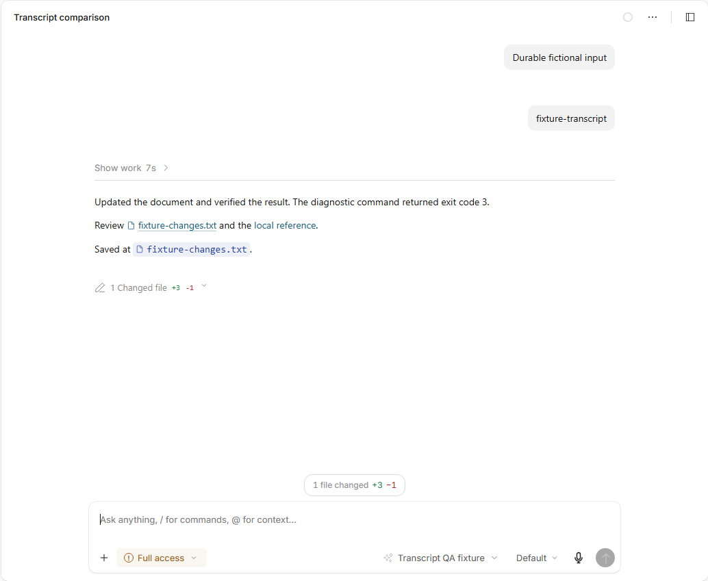
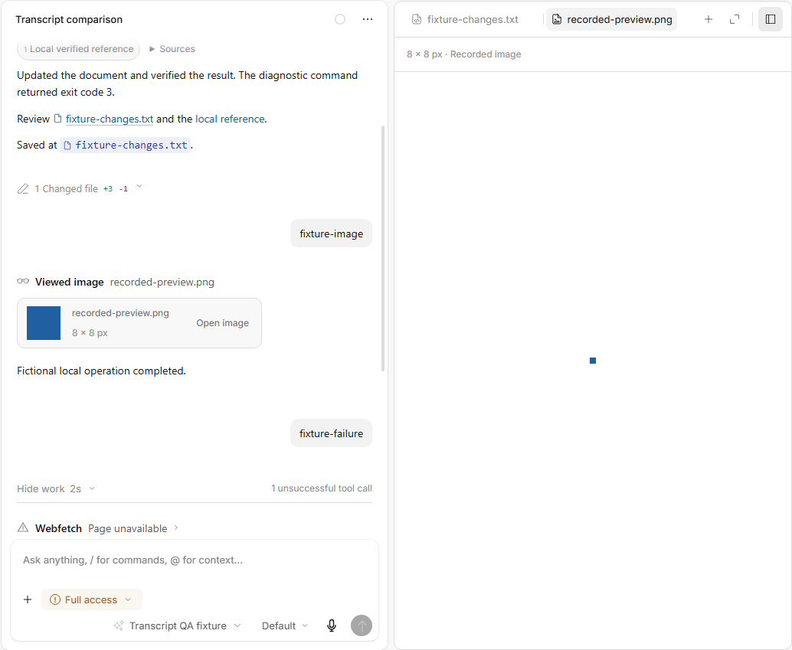

# Completed work and compact tool results

The 0.3.8 candidate follows the user's supplied **Codex desktop** and Bits & Bytes Cold Breath mod screenshots. The Codex work view in the reference is expanded; automatic folding at completion was separately requested by the user. Screenshots establish visual differences, not identical model configuration or a controlled model comparison.

## What the comparison showed

| Observation | Change |
| --- | --- |
| Codex gives work a muted disclosure and separates the final answer. Bits & Bytes mixes intermediate commentary, reasoning and operations into the reading column. | Completed turns start behind **Show work**, with elapsed time. The final assistant message, files and inline images remain visible. Expansion restores the original virtualized rows. |
| Windows MCP calls expose long identifiers, command bodies and destination paths. | Known PowerShell and FileSystem calls join activity groups and use short action labels. FileSystem uses **Worked with files**, since its identifier alone does not establish that it edited files. Unknown identifiers and full inputs remain in Details. |
| A failed web request or export presents a large red diagnostic, even when the model continues successfully. | Individual failed tool attempts use quiet, closed disclosures. Recorded HTTP 404/410 responses show **Page unavailable**. Exact errors and inputs remain accessible in bounded details; no recovery is inferred. |
| The generated mod's final answer repeats absolute Windows file paths. | Those inline references show a filename and icon with the full path in the title. Explicit link targets, stored Markdown and Copy response retain their original values. Directories, relative references and command expressions are preserved. |
| The older screenshots use generic document labels and Revision 1 file cards. | Generic artifact operations now say file. The 0.3.7 type icons, compact Office actions, panel tabs and revision-free chat cards are retained. |
| Native review at 125% revealed overlapping model, effort and microphone controls in a narrow split view. | The model wrapper can shrink and truncate while effort, microphone and Send keep independent bounds and pointer targets. |
| Reviewing the expanded real mod chat showed automatic following could scroll past the disclosed history. | Clicking or activating the work disclosure pauses automatic following before its rows change and when their sizes settle. Native replay checks that the expanded work header stays in view. |

## Boundaries

This is a presentation projection. It does not rewrite the model's final answer, remove stored messages, fabricate success, or change authorization policy. Active work, unfinished final messages, questions, inline images, interruptions, retries and task-level errors remain visible. Each turn owns its disclosure state; expanding one turn does not expand another. A renderer reload returns completed work to its compact default.

The failure count describes recorded error states, not task failure or recovery. A nonzero shell exit remains available in the command's actual result. Provider and account errors are not repaired by changing their presentation.

## Review loop

Pure tests cover projection, source preservation, independent turns, active work, tools, images and task errors. Native fixture checks exercise nesting, keyboard access, file opening, command output, recorded Windows/404 presentation, approvals, cancellation and reload. Local image fixtures retain actual PNG validation, Office exports and preview behavior; they make no paid image requests.

Two additional tasks ran through the real app composer using the selected `opencode/muse-spark-1.3-contributor-free` connection:

- **Waypoint Note:** 46 tool calls; a client-only NeoForge starter was changed into three location commands, built and packaged. An independent Gradle build also passes. Minecraft was not launched; in-game behavior needs a client check.
- **Study planner:** 27 tool calls; self-contained HTML and README were created and published. Browser checks cover adding subjects, allocation, completion, saved state, narrow layout and keyboard interaction.

The real tasks generated on an earlier 0.3.8 build. Their saved transcripts are reopened in the final package without another model request, checked in light/dark/narrow layouts, and verified unchanged. The screenshots are UI evidence, not a fresh paired Codex generation benchmark. All app instances and browser sessions used for QA are owned and isolated; the running user installation is preserved.

The second task exposed a functional HTML preview bug: `allow-scripts` alone blocks form submission before JavaScript submit handlers can run. The preview now also permits form handlers. Its origin stays opaque, and CSP still blocks outbound form navigation and network connections. Preview storage remains sandboxed; standalone-browser persistence is checked separately.

The hidden offscreen QA renderer crashes during iframe interaction. Static native captures and normal GPU renderer checks are therefore recorded separately. A hidden normal-renderer pointer click did not reach the iframe, so the final pointer check briefly showed only the owned QA window. Native pointer/keyboard checks then pass subject submission, allocation, completion and theme controls with no renderer errors. The temporary window closes after the check. The exported page separately passes pointer/keyboard and persistence checks in an owned headless Edge browser.

## Evidence

Native fixture captures and final verification totals are linked from [verification notes](../VERIFICATION.md). Private comparison screenshots, real-task profiles and credentials are excluded from Git. The deliverable evidence gallery includes the user's references and final native captures as crops, with UI pixels preserved.

### Completed turn

### Individual failed attempt

