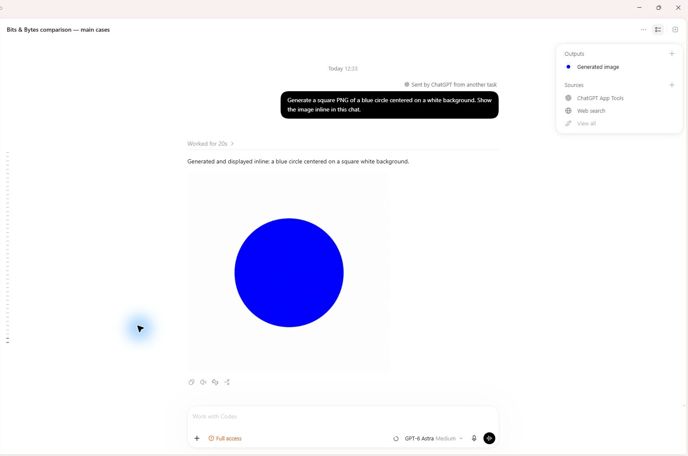
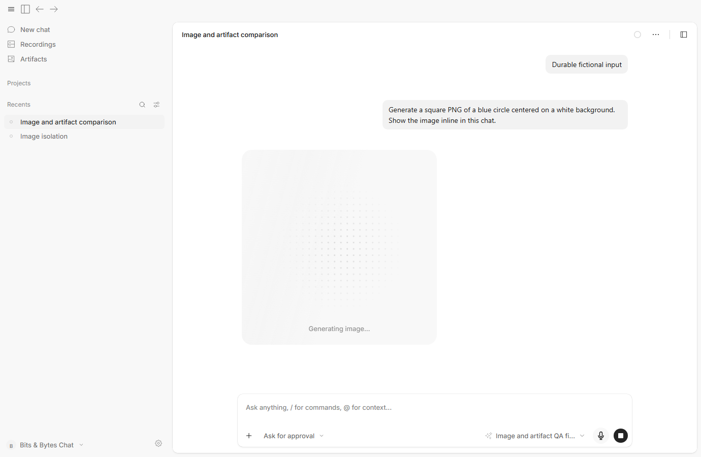
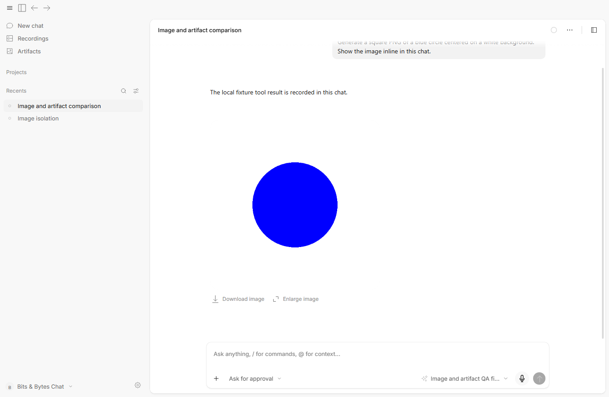
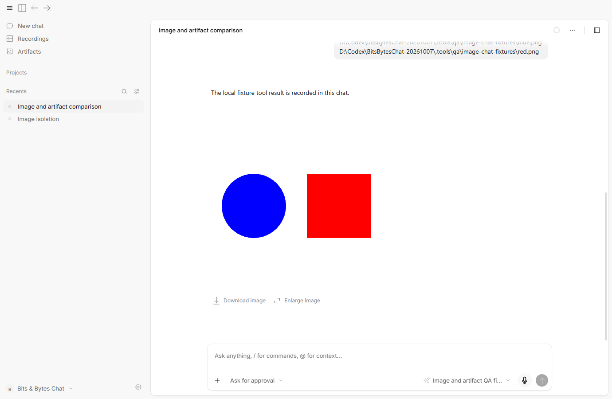
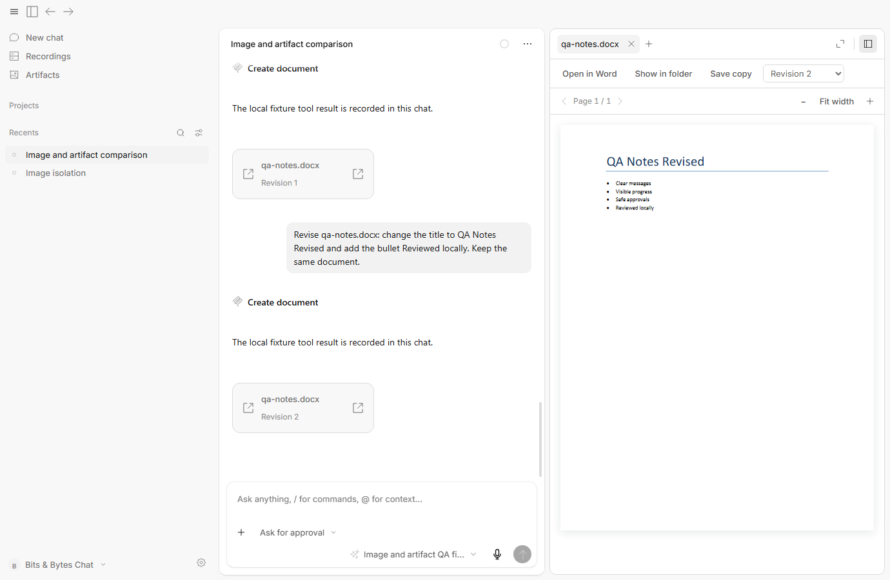
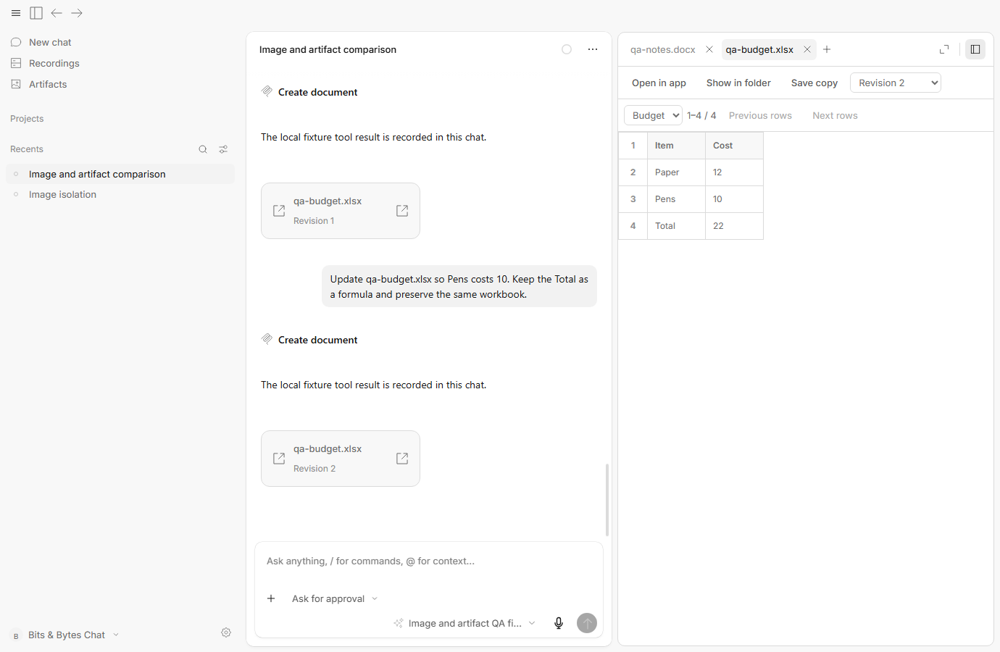
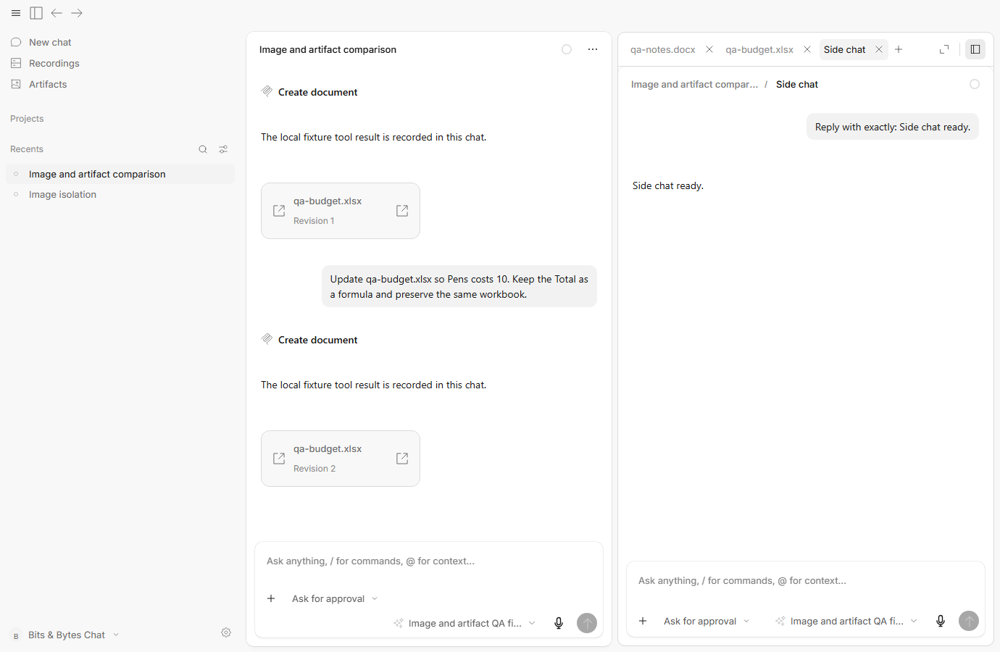

# Chat reliability QA — 10 October 2026

## Reference and controls

The reference is the actual Codex desktop app in Codex mode, in the chat **Bits & Bytes comparison — main cases**. Both it and the installed Bits & Bytes baseline completed **Reply with exactly: Ready for QA.** Real timestamped screenshots and their labeled comparison were opened and visually inspected before application investigation continued. Desktop screenshots were captured through the authorized Sky Windows API. Codex prompts used the authorized chat tool; its native document tabs and refresh controls were also exercised.

Full captures, the gate record, the comparison index, and final package reports are in the user-facing `outputs/qa-evidence/2026-10-10T10-06-54-671Z` directory of the initiating Codex chat. Earlier website and wrong-chat captures are excluded. The committed Codex image below is a crop of the real screenshot with the unrelated sidebar removed. No UI pixels were recreated.

The paired prompts and reference files are identical. Codex uses its actual model and image provider; the candidate uses a deterministic loopback provider, with no paid image requests. Window sizes and models differ. This establishes application behavior, transport and artifact correctness, rather than relative model quality or paid-provider availability. Fixture prose is explicitly labeled in the candidate captures.

## Observed outcomes

| Scenario                         | Actual Codex observation                                                                       | Verified candidate outcome                                                                                     |
| -------------------------------- | ---------------------------------------------------------------------------------------------- | -------------------------------------------------------------------------------------------------------------- |
| Square blue-circle PNG           | Real generated image appears inline                                                            | Real saved PNG replaces the same animated card; no image panel opens                                           |
| Merge blue circle and red square | Actual reference files produce an inline combined image                                        | Both files reach inference byte-for-byte; the combined PNG appears once                                        |
| Word creation and revision       | Native Word preview shows the title and bullets; refresh shows the revised title/fourth bullet | Actual DOCX and PDF contain the requested text, PDF canvas renders, revision 2 keeps the same artifact ID      |
| Budget creation and revision     | Native sheet shows Pens 10 and Total 22 after revision                                         | Actual workbook retains `=SUM(B2:B3)` and the grid changes from 20 to 22                                       |
| Image download/enlargement       | Reference has native image controls                                                            | Native Electron download saves valid PNG bytes; enlargement decodes the image                                  |
| Office downloads                 | Reference has native document controls                                                         | Save copy validates byte-identical copies of both Office revisions; hidden QA does not drive the native picker |
| Side chat and navigation         | Reference document tabs and chat navigation work                                               | A real side chat answers independently, closes, and preserves parent artifacts without another image request   |

Codex's Word agent reported that an external LibreOffice render was unavailable. Its **actual native Word preview still worked**. The screenshots establish that distinction; the assistant's text alone is not preview evidence.

## Reproduced problems and repairs

- Reference preparation could outlast Stop or a provider configuration change. Admission cancellation now covers reference reads, and a canceled request leaves a durable tombstone so a retry cannot submit the same billed operation.
- Approval cancellation did not reliably dismiss a pending request. Both protocol finalizers now dismiss interrupted requests, and execution checks cancellation again after approval.
- The approval dock hid the ordinary composer and its Stop control. The dock now offers Stop for the owning run, including interruption after a journal error.
- Code Mode could lose session/input/call ownership or receive a serialized JSON value as text. MCP metadata is flat and complete; marked native JSON preserves arrays, scalars and null.
- Long native calls could expire without progress. The local MCP adapter sends progress heartbeats; the real stdio test holds a call beyond 15 seconds and confirms one submission.
- Image generation showed duplicate generic Thinking rows around its own progress card. Image-only tool groups now use the image card; mixed tool groups remain visible.
- Model discovery did not establish edit support. Editing requires both image input and reference-parameter support. Text-only models reject references before inference, and the tool exposes capability information.
- Image artifacts opened/restored panel tabs automatically. Generated images now remain in the owning transcript, retain saved revisions and load near the viewport.

## Accepted verification

The exact final packaged executable passes 11 image/document/side-chat groups and 15 transcript/access groups, with **zero renderer errors**. The image suite records the executable path and ASAR SHA-256. It exercises the actual engine, Code Mode, native MCP adapter, image service, decoder, artifact worker and renderer. HTTP image inference is held locally to inspect pending, approved, canceled and failed states.

Other accepted checks:

- 331 Bun desktop tests, 12 Node mobile HTTPS tests, one Node SQLite draft check.
- 103 core permission/session-runner tests; 128 OpenCode permission/Code Mode tests; 41 message tests.
- 44 app tests; 12 session UI tests; two schema diagnostic tests; 12 Python document tests; 15 Python audio tests.
- Four Office Save copy checks and three actual JPEG/WebP/immutable-artifact pipeline checks.
- Seven package typechecks, production build, MCP syntax and whitespace checks.
- Package hashes match all 1,803 compiled files and 39 runtime files; the tested ASAR matches the installer package.

Total: **674 JavaScript/TypeScript tests and 27 Python tests passed**. Thirty-four optional desktop tests were skipped in the broad run. Some decoder/artifact behavior from that skipped set is separately exercised by the explicit pipeline and UI checks; no claim is made that every skipped case ran.

The push hook also caught an unbranded session-ID fixture; it now uses the schema's constructor, and its two tests and package typecheck pass. The full inherited monorepo hook remains blocked by the previously documented enterprise declaration symlink, materialized as plain text on Windows (TS1128). The push uses that documented per-command hook bypass. Relevant app checks pass; this is not a claim that the full monorepo typecheck passes.

The initial broad Bun run failed Node-specific mobile hooks and lacked `node:sqlite`. Those checks pass under Node. The first Python audio run used the artifact interpreter, which lacks `httpx`; all 15 audio tests pass under the recording interpreter. Other unsuccessful harness attempts used a stale locator label/scope and a strict Buffer-versus-Uint8Array assertion. Their reports remain in `.tools/qa/results`. UI QA also caught the missing approval Stop control, which was a real product defect and was repaired before the accepted runs.

The five-sample 55,000-character input/layout benchmark is 9.5 ms before and 9.8 ms after at the median. This narrow measurement is not an inference-speed or general chat-performance claim.

## Reproduction and review limits

Run package tests from their package directories. Image/chat fixtures require the installed artifact Python runtime and the isolated packaged app. From `packages/desktop`, set `BB_QA_EXECUTABLE` to the final `win-unpacked/BitsBytesChat.exe`, choose `BB_QA_REPORT`, and run `node scripts/verify-image-chat.mjs`. `BB_QA_ISOLATED=1` and `BB_QA_HIDDEN=1` are required for the loopback image endpoint override. The script supplies them; the regular app does not use that override.

Then run `bun run scripts/verify-artifact-downloads.ts` with the same report name, `bun run scripts/verify-image-pipeline.ts`, and `node scripts/verify-transcript-presentation.mjs`. Mobile HTTPS tests run under Node after bundling their TypeScript with Bun; the SQLite draft check also needs Node's actual SQLite implementation. Python document and audio suites use their respective artifact and recording interpreters.

The installer is a local unsigned 0.3.6 candidate for human review. The running user app was preserved. Install the candidate to apply the changes. Live paid image providers, account-specific availability, native Office save-picker interaction, and broad third-party tool behavior were not established by the fixture runs.
