# Bits & Bytes Chat — interface feature screenshots

These are unedited captures of the final 0.3.5 candidate, taken in hidden isolated profiles with fictional conversations and local provider fixtures. They show Bits & Bytes Chat, not ChatGPT or Codex. The supplied sidebar screenshot guided the geometry and behavior; these captures do not establish whole-image pixel identity with another renderer.

The candidate is `.tools/qa/interface-patch-accepted-r1-package/BitsBytesChat-win-x64.exe`. [Verification](../VERIFICATION.md) records its build audit, scoped tests and 44 final packaged checks. This gallery contains visible features; crash, unsupported-request and other diagnostic captures remain private QA output.

## Sidebar and conversation navigation

A single 332px sidebar contains utilities, expandable pinned projects, recent chats and fixed account/settings controls. Conversation rows are 28px, with hover/focus menus. Search, filters and View all operate on paginated saved history. Width can be resized from 260–420px; narrow windows use a drawer.

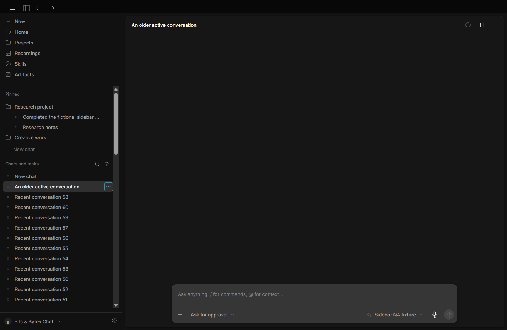

Other layouts: [light 100%](screenshots/035-interface-organization-light-100-sidebar.png), [dark 125%](screenshots/035-interface-organization-dark-125-sidebar.png), [light 125%](screenshots/035-interface-organization-light-125-sidebar.png), [narrow drawer](screenshots/035-interface-organization-narrow-drawer.png).

## Projects

Create a project with just a name, optionally choose a default working folder, and organize multiple chats inside it. Moving an existing chat keeps its original execution folder, permissions, queue and artifacts. Projects support rename, pin/order and removal; chats support rename, move, archive and restore.

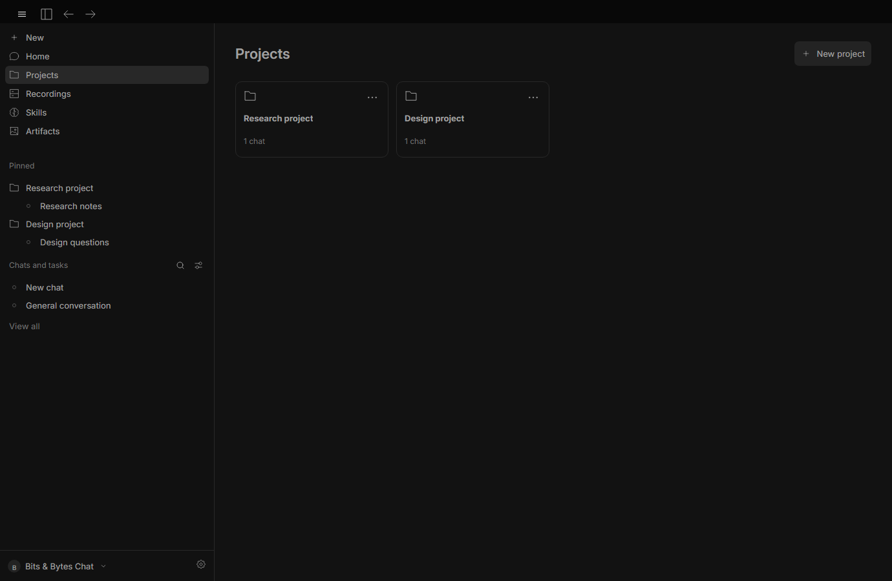

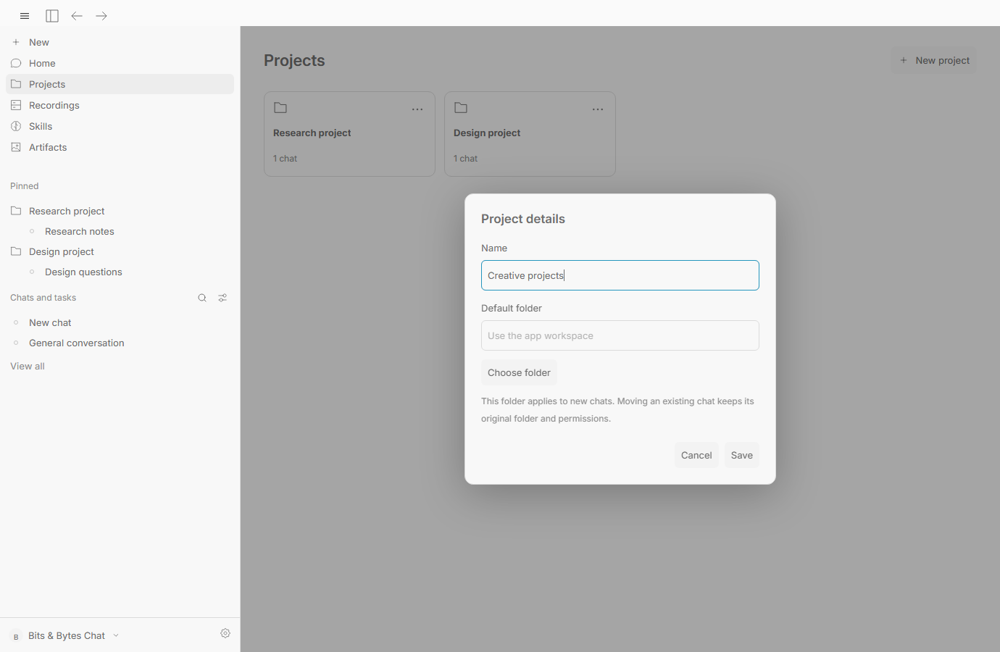

Other views: [light projects](screenshots/035-interface-organization-light-projects-manager.png), [dark creation dialog](screenshots/035-interface-organization-dark-project-create.png).

## Compact browser

Back, Forward, Reload/Stop, address and overflow share one compact toolbar. The overflow contains Copy URL and Open externally. Typed addresses survive navigation events; Escape restores the current URL. Document/browser tabs remain in the right panel. Narrow layouts expose a Collapse control and retain the mounted chat underneath.

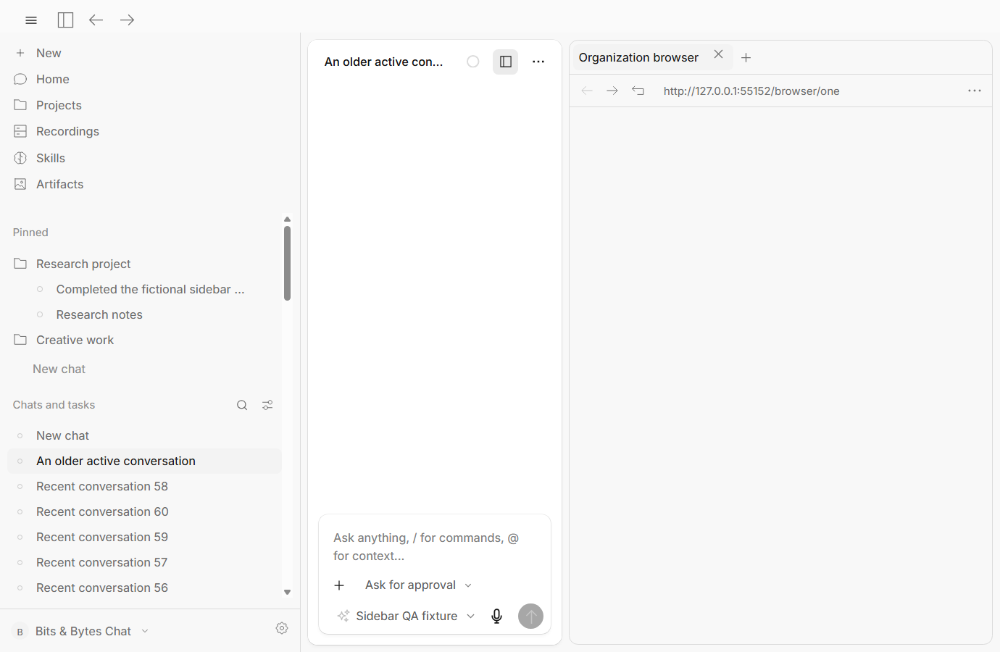

Other views: [100% controls](screenshots/035-interface-organization-browser-100.png), [overflow menu](screenshots/035-interface-organization-browser-menu.png), [narrow panel](screenshots/035-interface-organization-narrow-panel.png).

Electron's separate native browser surface is excluded from the hidden parent-window bitmap above. Its actual content was captured separately and verified against its URL, title, DOM and native bounds: [native page 100%](screenshots/035-interface-organization-browser-native-100.png), [native page 125%](screenshots/035-interface-organization-browser-native-125.png). The images are not composited.

## Readable tool activity

Human operation titles replace raw tool identifiers in the normal transcript. An explicitly retried operation is grouped only when trusted lineage and verified output match. Expand the recovery/details disclosure to inspect every attempt, arguments and original diagnostic.

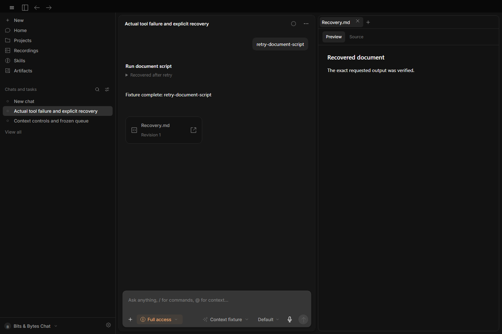

Other views: [light compact activity](screenshots/035-interface-context-activity-compact-tool-recovery-light.png), [dark expanded details](screenshots/035-interface-context-activity-readable-tool-recovery-dark.png), [light expanded details](screenshots/035-interface-context-activity-readable-tool-recovery-light.png).

## Markdown Preview and Source

Markdown opens as rendered content with tables, code blocks and authorized relative images. Preview and Source retain independent scroll positions. Artifact revisions show their exact saved text/images; workspace documents retain their source editor.

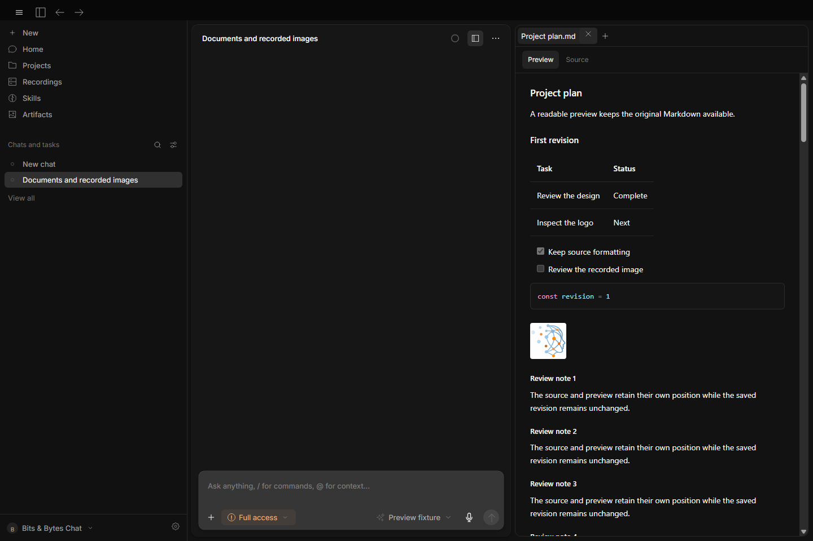

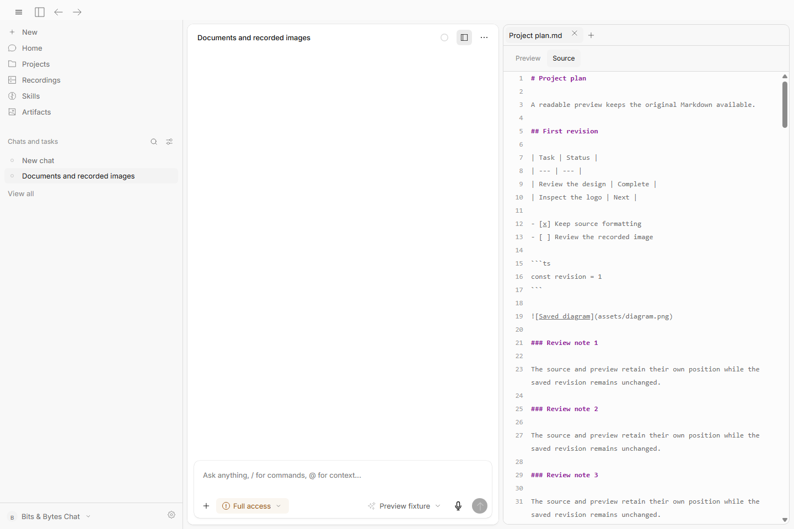

| View | Dark | Light |
|---|---|---|
| Artifact preview | [Capture](screenshots/035-interface-previews-markdown-preview-dark.png) | [Capture](screenshots/035-interface-previews-markdown-preview-light.png) |
| Artifact Source | [Capture](screenshots/035-interface-previews-markdown-source-dark.png) | [Capture](screenshots/035-interface-previews-markdown-source-light.png) |
| Historical revision | [Capture](screenshots/035-interface-previews-markdown-historical-dark.png) | [Capture](screenshots/035-interface-previews-markdown-historical-light.png) |
| Workspace preview | [Capture](screenshots/035-interface-previews-workspace-markdown-dark.png) | [Capture](screenshots/035-interface-previews-workspace-markdown-light.png) |
| Workspace source editor | [Capture](screenshots/035-interface-previews-workspace-markdown-source-dark.png) | [Capture](screenshots/035-interface-previews-workspace-markdown-source-light.png) |

## Recorded image actions

Image reads show a thumbnail, filename, decoded dimensions and **Open image**. Reading preserves the selected document. Choosing the action opens the immutable recorded snapshot in another panel tab; side-chat reads retain their source ownership.

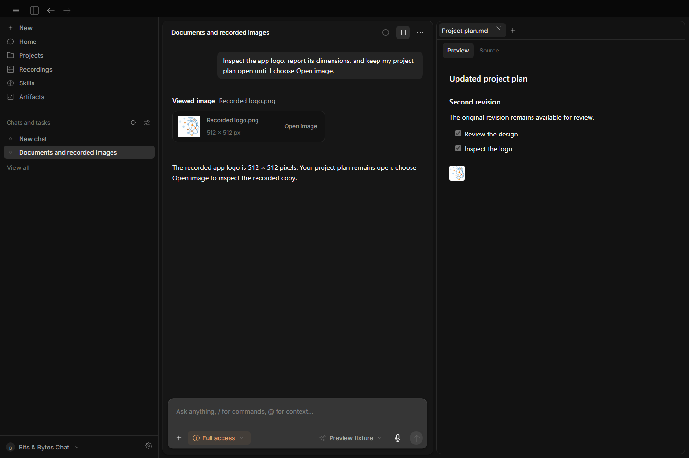

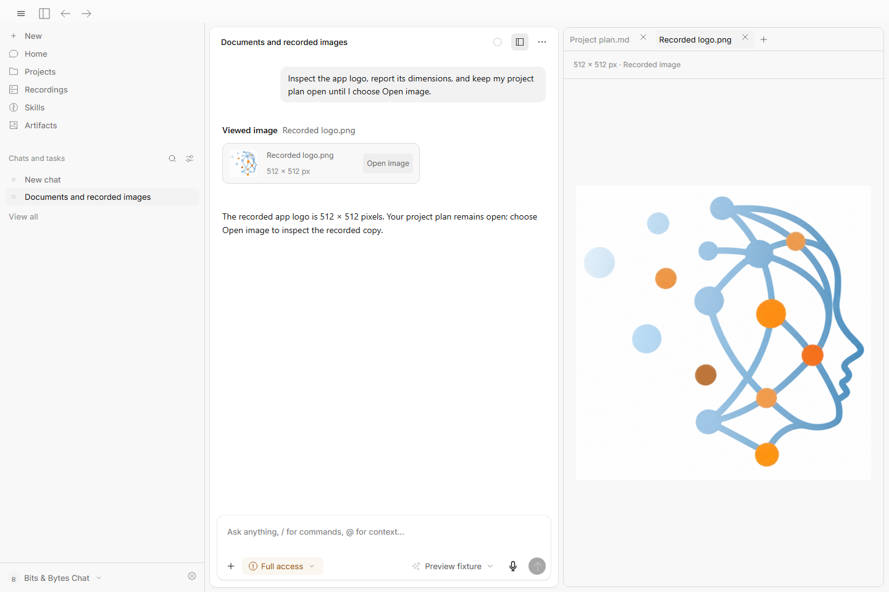

Other views: [light image action](screenshots/035-interface-previews-recorded-image-action-light.png), [dark image panel](screenshots/035-interface-previews-recorded-image-panel-dark.png), [dark side-chat image](screenshots/035-interface-previews-side-chat-recorded-image-dark.png), [light side-chat image](screenshots/035-interface-previews-side-chat-recorded-image-light.png).

## Context-window selection

Right-click a model row or the selected model, use Shift+F10, or activate its options button. Recommended preserves current behavior; custom choices are filtered by reported capacity and safe reserves. Choices are saved per chat/provider/model, and queued requests retain their original limit. This fixture reports 128,000 tokens; it does not advertise model availability on the user's account.

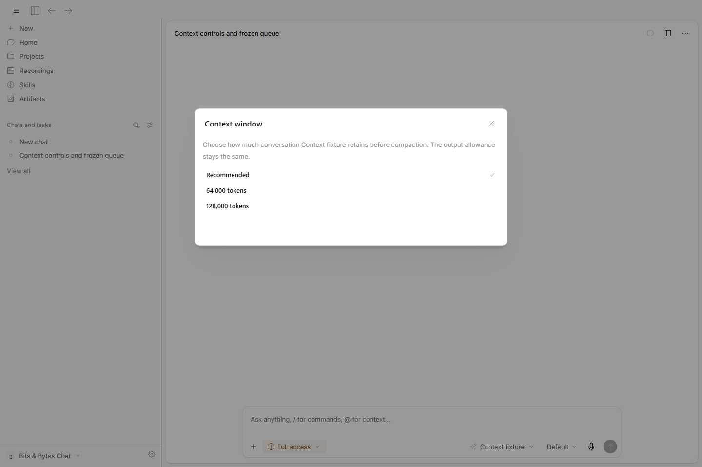

[Dark context menu](screenshots/035-interface-context-activity-context-choices-dark.png).

## Image-generation connection

**Settings → Tools & permissions → Image generation** uses a separate encrypted OpenAI API key. API image charges are separate from ChatGPT-plan access. **Test and enable image generation** explicitly creates one billed verification image; the tool is advertised only after the PNG succeeds. Generated PNGs enter the existing revisioned artifact system.

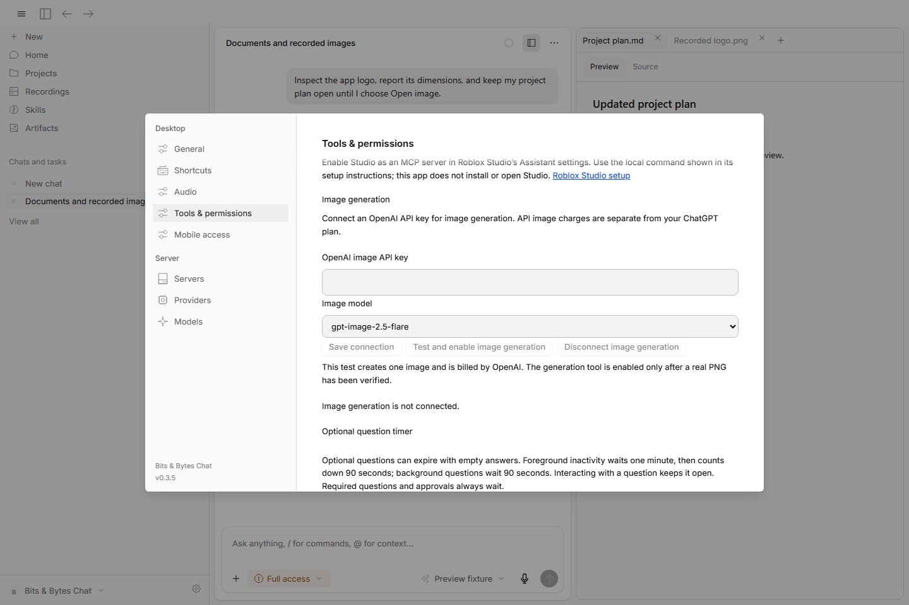

[Dark image settings](screenshots/035-interface-previews-image-provider-settings-dark.png).

No image API key was configured during QA. Provider behavior and PNG publication were tested with controlled responses; a successful live paid generation is not claimed.

## Product identity

Startup/loading, local OAuth callback pages, error frames, app icons and Windows installer assets use Bits & Bytes branding. Required legal attribution and provider-controlled consent identity are retained.

