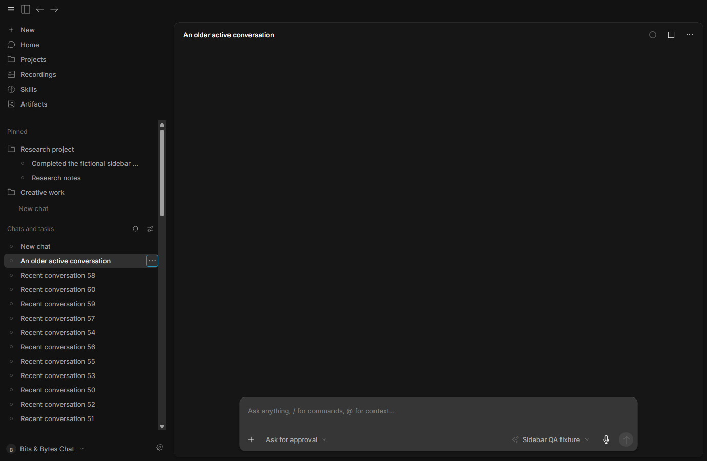
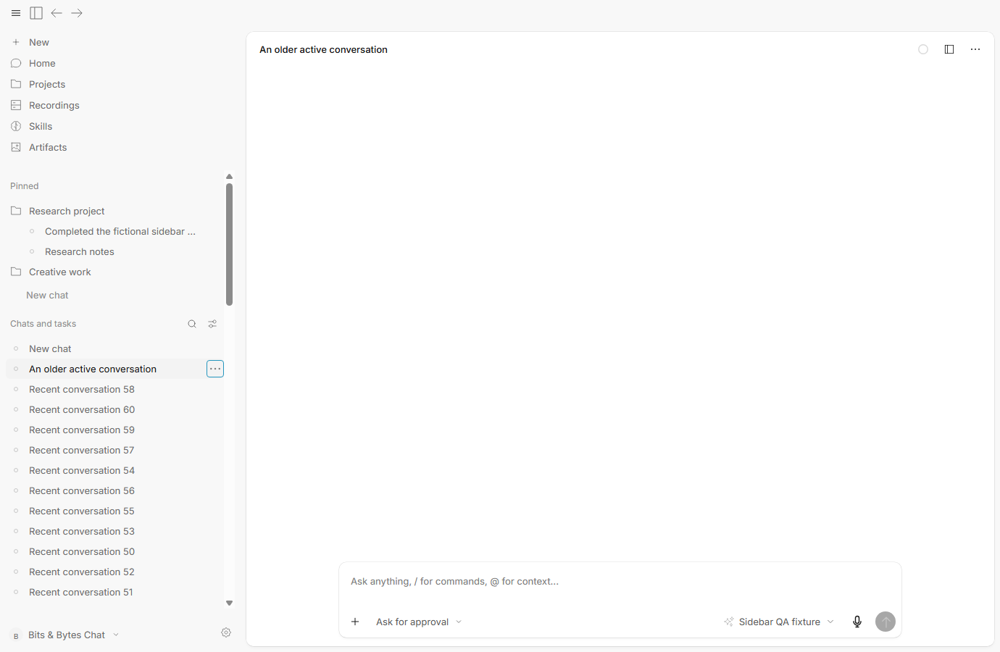

# Sidebar and titlebar finish

Actual, unedited screenshots from the latest 0.3.5 candidate, captured with fictional conversations in a hidden isolated profile. The sidebar and account divider lines are removed. The entire top bar matches the sidebar tint, the chat/right panel use a separate content tint, and the top-left controls align with the navigation icons below.

The installer is `.tools/qa/sidebar-chrome-package/BitsBytesChat-win-x64.exe`. [Verification](../VERIFICATION.md) records the package audit, theme/alignment measurements and 14 passed packaged checks.

## Dark mode

[Dark mode at 125%](screenshots/035-sidebar-chrome-dark-125.png).

## Light mode

[Light mode at 125%](screenshots/035-sidebar-chrome-light-125.png).
