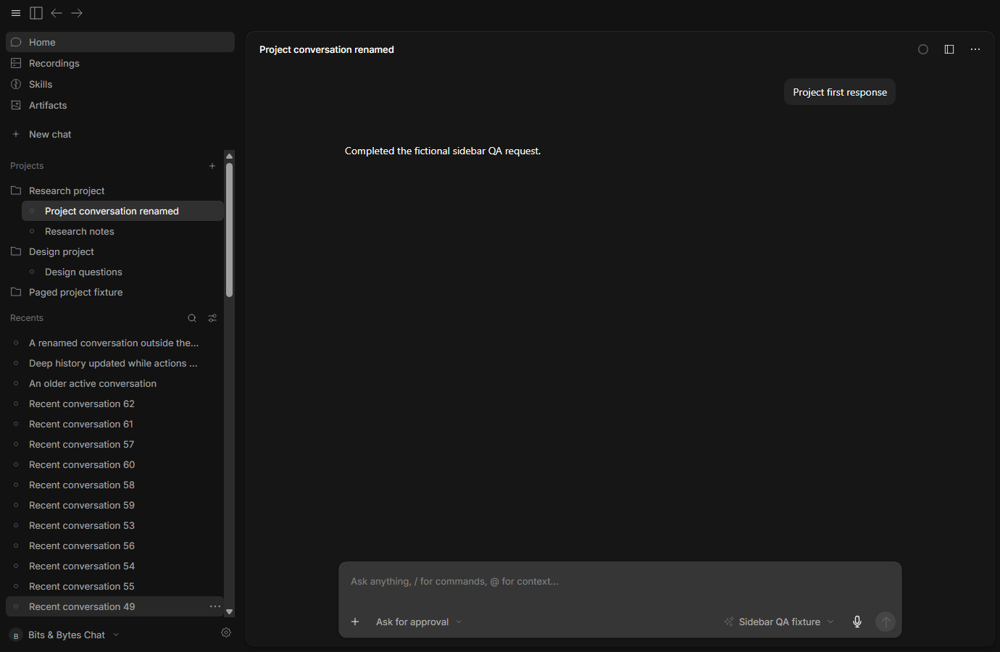
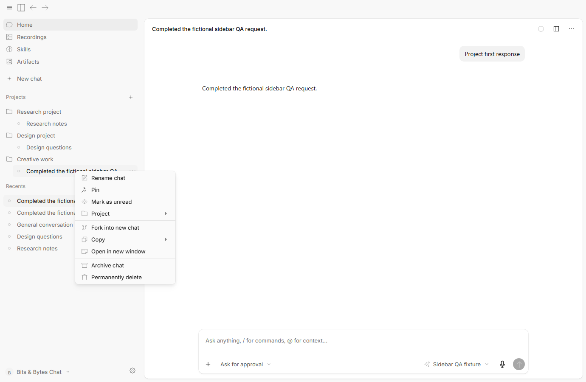
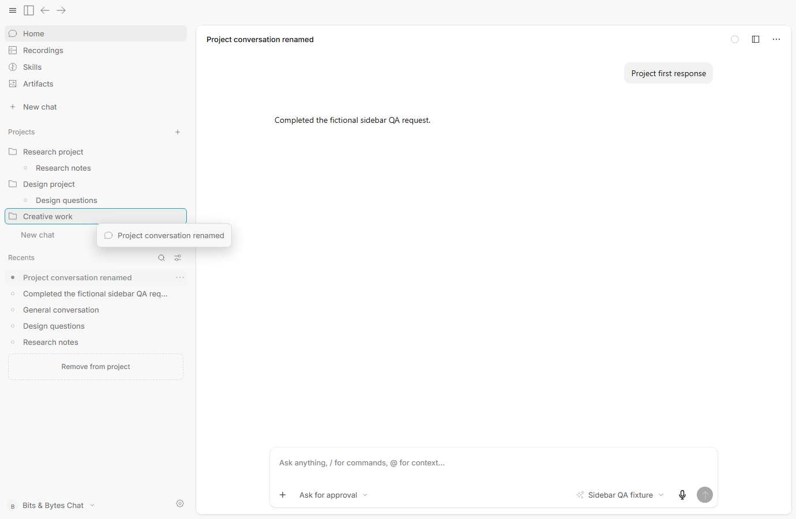
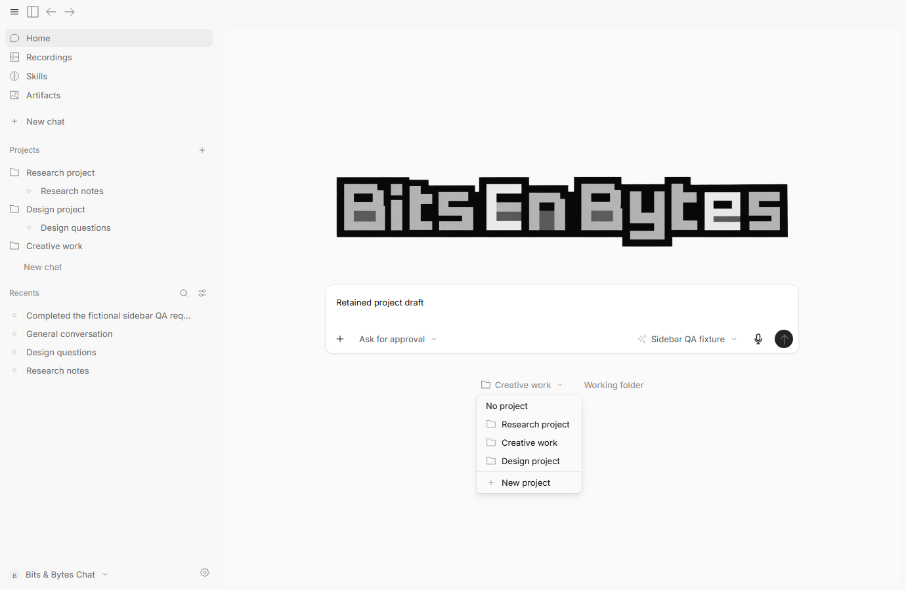
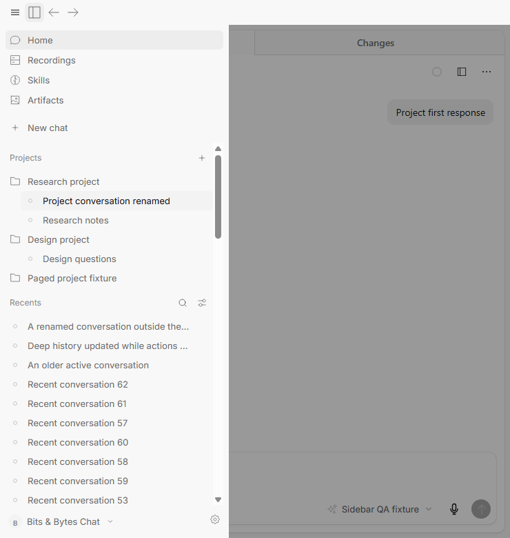

# Sidebar navigation and optional projects

Actual, unedited captures of the tested 0.3.5 candidate, using fictional conversations in hidden isolated windows. Home is the chat workspace; New chat sits below Home, Recordings, Skills and Artifacts. Projects and conversations live in the sidebar, and utility pages hide that navigation while retaining the account/settings footer.

The candidate installer is `.tools/qa/sidebar-navigation-package/BitsBytesChat-win-x64.exe`. [Verification](../VERIFICATION.md) records the package audit, scoped checks and all 26 passing packaged acceptance groups. The installed user app and published release were preserved.

## Sidebar, conversation menu and dragging

The sidebar is 332 CSS px wide by default, with 28px conversation rows. Right-click, the trailing ellipsis and keyboard context-menu access share the same actions. Dragging shows a compact conversation preview and highlighted project target, with a separate Remove from project target.

| Appearance | Expanded projects and recents | Conversation menu | Pointer drag |
|---|---|---|---|
| Dark, 100% | [Screenshot](screenshots/035-sidebar-navigation-dark-100-sidebar.png) | [Screenshot](screenshots/035-sidebar-navigation-dark-100-menu.png) | [Screenshot](screenshots/035-sidebar-navigation-dark-100-drag.png) |
| Dark, 125% | [Screenshot](screenshots/035-sidebar-navigation-dark-125-sidebar.png) | [Screenshot](screenshots/035-sidebar-navigation-dark-125-menu.png) | [Screenshot](screenshots/035-sidebar-navigation-dark-125-drag.png) |
| Light, 100% | [Screenshot](screenshots/035-sidebar-navigation-light-100-sidebar.png) | [Screenshot](screenshots/035-sidebar-navigation-light-100-menu.png) | [Screenshot](screenshots/035-sidebar-navigation-light-100-drag.png) |
| Light, 125% | [Screenshot](screenshots/035-sidebar-navigation-light-125-sidebar.png) | [Screenshot](screenshots/035-sidebar-navigation-light-125-menu.png) | [Screenshot](screenshots/035-sidebar-navigation-light-125-drag.png) |

## New chats and optional projects

Ordinary New chat defaults to No project. The project picker is separate from Working folder. Unsent drafts have no conversation row; sending the first durable input adds the conversation. Creating a project requires only its name, with an optional default folder.

| Feature | Dark mode | Light mode |
|---|---|---|
| Ordinary new chat, No project | [Screenshot](screenshots/035-sidebar-navigation-dark-ordinary-new-chat.png) | [Screenshot](screenshots/035-sidebar-navigation-light-ordinary-new-chat.png) |
| Name-only project creation | [Screenshot](screenshots/035-sidebar-navigation-dark-name-only-project.png) | [Screenshot](screenshots/035-sidebar-navigation-light-name-only-project.png) |

## Utility navigation and narrow layouts

Recordings, Skills and Artifacts hide the chat-navigation section. Returning Home restores the conversation or unsent draft, including its text, attachments and panels. The footer stays at the bottom. Narrow windows use a sidebar drawer.

[Dark utility navigation](screenshots/035-sidebar-navigation-dark-utility-navigation.png) · [Light utility navigation](screenshots/035-sidebar-navigation-light-utility-navigation.png)

