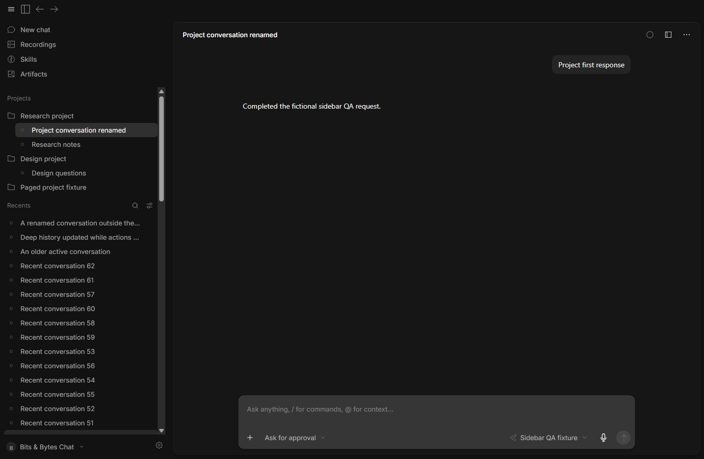
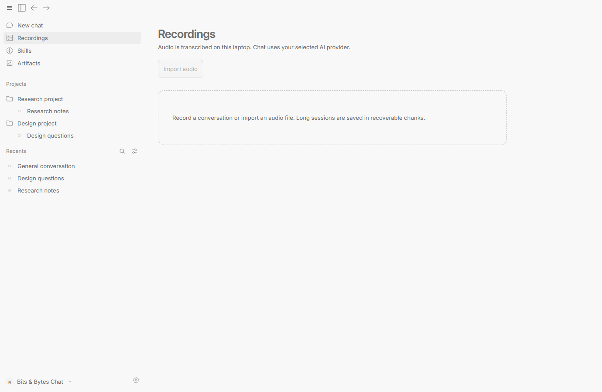
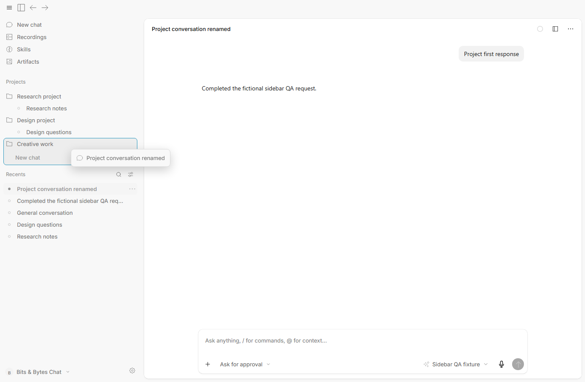

# Persistent sidebar and project drop targets

Actual, unedited captures from the 0.3.5 follow-up candidate, using fictional conversations in hidden isolated windows. New chat replaces Home at the top and keeps its chat-bubble icon. Projects and chats stay visible on Recordings, Skills and Artifacts. The sidebar tint, borderless finish and titlebar alignment are retained.

The installer is `.tools/qa/sidebar-refinement-package/BitsBytesChat-win-x64.exe`. [Verification](../VERIFICATION.md) records the exact package audit and acceptance results. The installed user app and published release were preserved.

## Sidebar and utilities

| Appearance | Sidebar | Conversation menu | Full-folder drag highlight |
|---|---|---|---|
| Dark, 100% | [Screenshot](screenshots/035-sidebar-refinement-dark-100-sidebar.png) | [Screenshot](screenshots/035-sidebar-refinement-dark-100-menu.png) | [Screenshot](screenshots/035-sidebar-refinement-dark-100-drag.png) |
| Dark, 125% | [Screenshot](screenshots/035-sidebar-refinement-dark-125-sidebar.png) | [Screenshot](screenshots/035-sidebar-refinement-dark-125-menu.png) | [Screenshot](screenshots/035-sidebar-refinement-dark-125-drag.png) |
| Light, 100% | [Screenshot](screenshots/035-sidebar-refinement-light-100-sidebar.png) | [Screenshot](screenshots/035-sidebar-refinement-light-100-menu.png) | [Screenshot](screenshots/035-sidebar-refinement-light-100-drag.png) |
| Light, 125% | [Screenshot](screenshots/035-sidebar-refinement-light-125-sidebar.png) | [Screenshot](screenshots/035-sidebar-refinement-light-125-menu.png) | [Screenshot](screenshots/035-sidebar-refinement-light-125-drag.png) |

[Dark utility navigation](screenshots/035-sidebar-refinement-dark-utility-navigation.png) · [Narrow sidebar drawer](screenshots/035-sidebar-refinement-narrow-drawer.png) · [Conversation actions](screenshots/035-sidebar-refinement-light-chat-menu.png)

## Project controls and dragging

The project plus is hidden at rest, appears on heading hover or keyboard focus, and stays accessible on touch devices. A drop outlines the entire folder, including its nested chats. Remove from project is shown only for a conversation that already belongs to a project.

[Dark project-plus hover](screenshots/035-sidebar-refinement-dark-project-add-hover.png) · [Light project-plus hover](screenshots/035-sidebar-refinement-light-project-add-hover.png)

## Optional projects and drafts

New chat still defaults to No project. Selecting a project remains independent of the working folder, and unsent drafts remain absent from the conversation list. Project creation needs only a name.

| Feature | Dark | Light |
|---|---|---|
| Ordinary new chat | [Screenshot](screenshots/035-sidebar-refinement-dark-ordinary-new-chat.png) | [Screenshot](screenshots/035-sidebar-refinement-light-ordinary-new-chat.png) |
| Name-only project creation | [Screenshot](screenshots/035-sidebar-refinement-dark-name-only-project.png) | [Screenshot](screenshots/035-sidebar-refinement-light-name-only-project.png) |

[Optional project picker](screenshots/035-sidebar-refinement-light-optional-project-picker.png)
