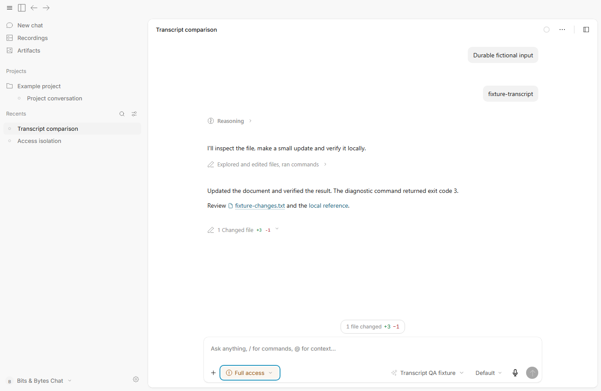
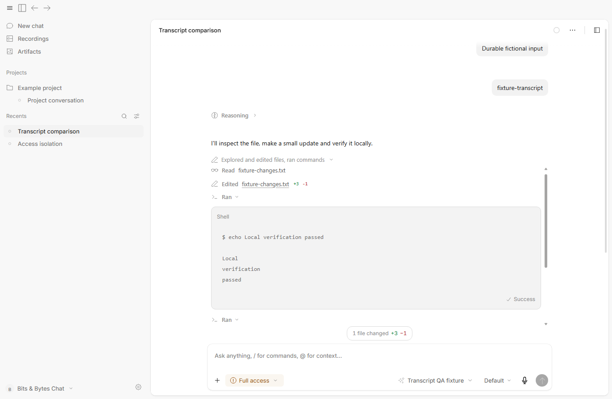
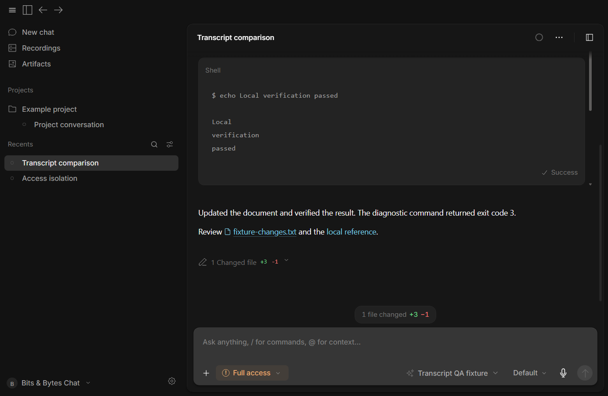
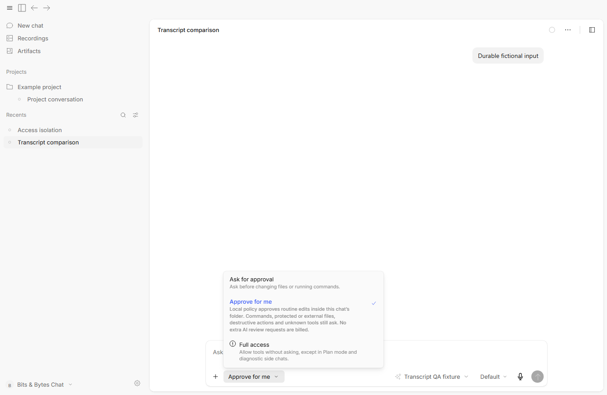
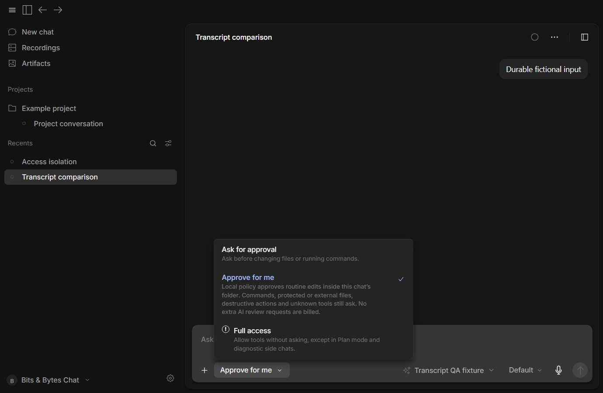
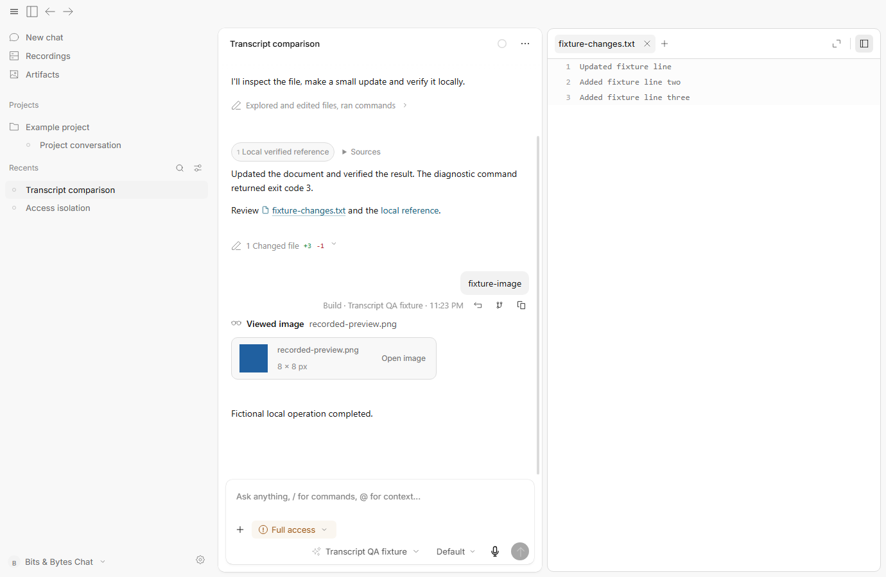

# Transcript screenshots — 9 October 2026

Actual captures from the hidden packaged Bits & Bytes Chat candidate, using fictional files, a loopback provider and an isolated profile. These are candidate screenshots, not Codex screenshots. [The comparison report](TRANSCRIPT_COMPARISON.md) records the supplied Codex references and distinguishes observed behavior from unverified mechanics.

## Compact conversation

Commentary stays readable. Reasoning, routine activity and the duplicate changed-file list start collapsed. The actual local-file link includes a document icon; the composer retains the review count.

## Expanded file and command activity

One group contains the actual read, edit and commands. Each operation expands separately. Recorded output has a bounded scroll area, Shell label, copy action and truthful process status.

## Access selection

The multiline options have separate pointer targets and remain readable at both scales. Packaged interaction checks exercise every mode transition and actual manual/automatic workspace-write approvals.

## References and image reads

Recorded sources remain available. An image read keeps its thumbnail, dimensions and explicit Open image action while the existing document stays selected. The tiny solid-color PNG is intentional test data.

