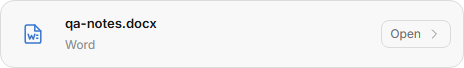
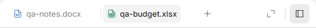

# Chat and panel visual polish — 0.3.7

## Findings from the supplied screenshots

The original app repeated tool activity with large gaps, used two generic open-file arrows on its file card, and exposed internal "Revision 1" metadata. The Codex reference uses a wider row, a recognizable Word icon, a filename and file-type subtitle, and a small opening control. Its panel tabs use subdued icons, filenames and separators.

Source inspection found a 24px text margin stacked on the timeline padding, and invisible response actions reserving space above file cards. The revised layout removes the duplicate margin and puts those actions after the card. Tool-only rows have a smaller gap while ordinary paragraphs retain the existing timeline spacing.

## Updated interface

Cards have a shared file-type icon, filename, type label and Open control. Word is blue, Excel green, PowerPoint orange and PDF red; code, image and generic files have their own glyphs. Image artifacts continue to display inline. Initial revision metadata is removed from chat cards; per-turn revision selection and preview history still work.

Tabs use small type icons, subtle separators and restrained active styling. Close buttons appear on hover or focus. Long filenames ellipsize and the tab row remains horizontally scrollable.

Open in Word/default app, Show in folder and Save copy use icon buttons with tooltips and accessible labels. The existing actions remain connected to their original IPC callbacks. Historical previews keep their version selector and their current-version opening label.

## Comparison controls and limits

The reference is the three screenshots supplied by the user: their app, actual Codex chat, and actual Codex panel tabs. Updated images are native Electron offscreen paints of the exact packaged candidate. UI pixels are cropped without recreation. Fixture prompts, filenames and column widths differ from the supplied references; this comparison concerns visual layout, not model output quality. Provided reference images are retained only in the local deliverable evidence, not committed.

The full local evidence contains wide, narrow, light, dark at 125%, Word/Excel revisions, toolbar hover and the labeled before/reference/after file-card comparison. Native checks verify geometry, accessible button names, correct icons, no initial revision label, reachable response actions, no horizontal card overflow and no development-channel badge. Live provider quality, native Microsoft Word launch and the native Save copy picker are outside hidden visual QA. See [Verification](../VERIFICATION.md) for counts, build hashes and measured composer timings.
