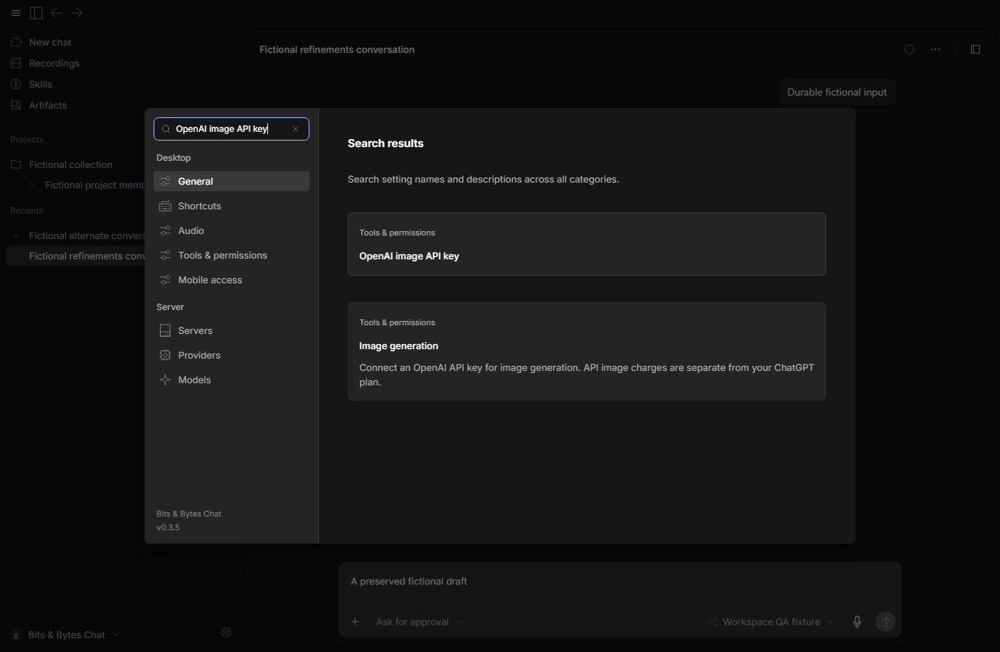
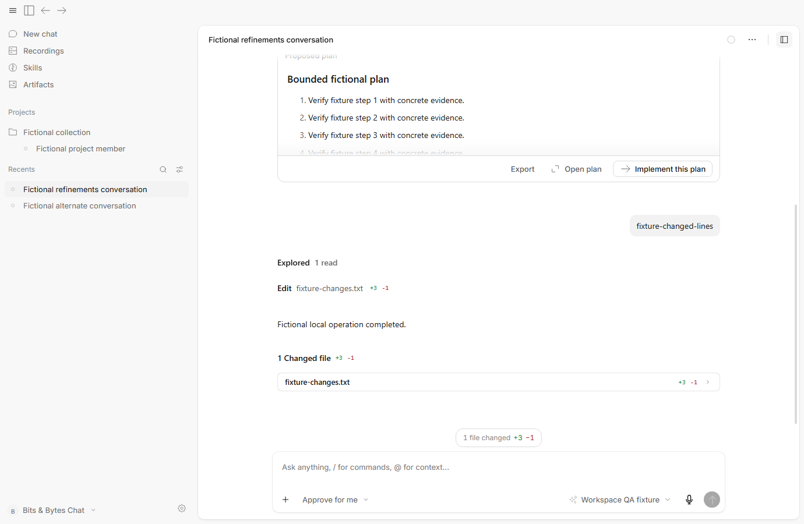
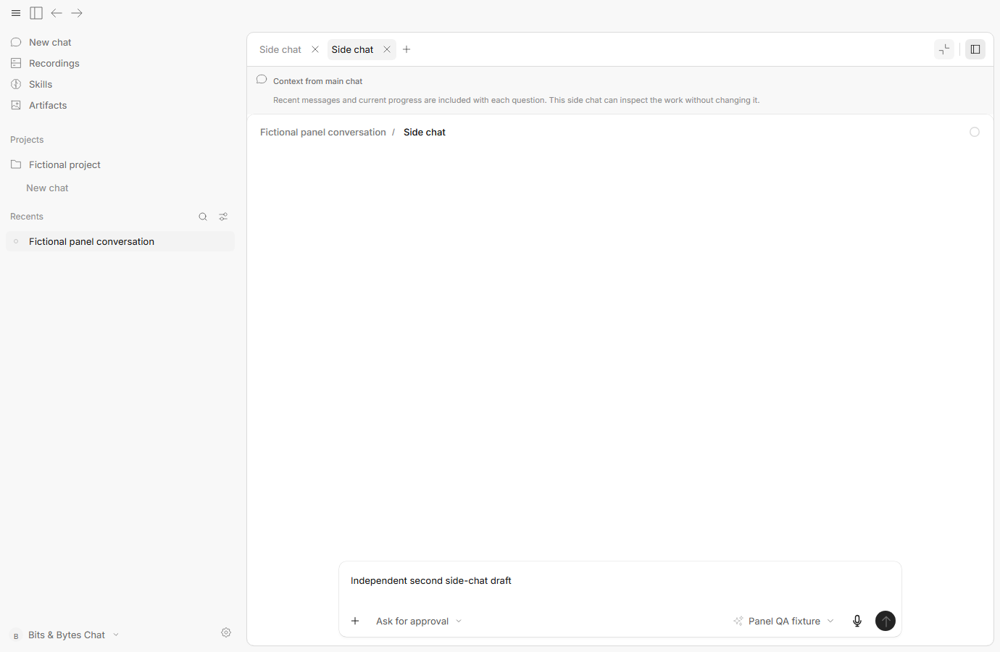
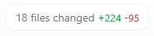

# Workflow refinements — 9 October 2026

These are actual hidden, isolated Bits & Bytes Chat 0.3.5 captures using fictional conversations and a local provider fixture. No account credentials or paid model requests were used. The running user installation was preserved.

## Settings search

Search covers categories, translated setting titles and descriptions. Selecting a result reveals its control. Keyboard navigation, Ctrl+F, clearing, Escape and draft preservation were checked.

## Composer, Plan and file changes

The Plan excerpt remains visible; the complete plan opens in the panel. Implement uses a compact outlined action. The file-change pill above the composer comes from a real fixture edit, shows +3/−1, and opens Code review. Send/Stop use compact icons, and Approve for me is selected here. Plan/Goal chips appear beside the access control while active.

## Focused panel and independent side chats

Focus panel fills the conversation area while keeping the main chat mounted. Restore split view returns its preferred width and draft. Two temporary side chats retain separate drafts; plus follows the tabs, and each close button sits beside its title. The context notice explains the bounded recent parent snapshot provided with each question.

## Codex reference

This native reference crop contains only Codex's changed-files control. It was captured passively without activating or driving that window. It informed the pill's compact rounded shape, placement and colored totals.

